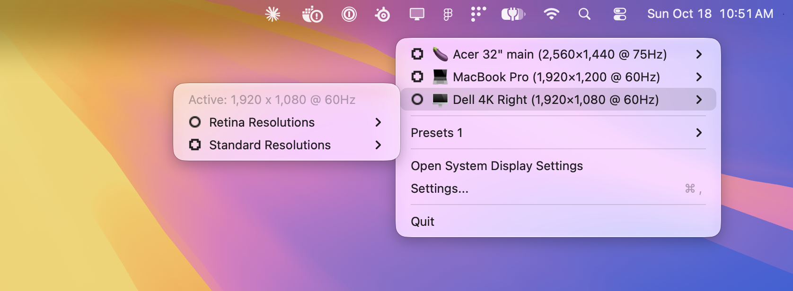

# ScreenSmith

**ScreenSmith is a free, open-source macOS menu bar app for changing the screen resolution, refresh rate and rotation of every connected display, including HiDPI (Retina) scaled modes that System Settings hides.** It's a lightweight display manager and resolution switcher for MacBooks, external monitors and multi-monitor setups, on Apple silicon and Intel Macs.

▶️ [Watch the ScreenSmith demo on YouTube](https://youtu.be/ZIteqB0Rkoo)

## Features

- **Every resolution, one click away:** switch any display between all of its Retina (HiDPI) and standard resolutions and refresh rates from the menu bar.
- **Native resolution, clearly marked:** see each panel's true native resolution and which modes are pixel-perfect (1:1 or Retina 2×).
- **MacBook Pro notch support:** on notched MacBooks, modes are split into full-panel (around the notch) and below-notch resolutions.
- **Display rotation:** rotate any display to 90°, 180° or 270°.
- **Presets:** save the resolution and rotation of all your monitors and restore the whole setup in one click, for example when docking a laptop.
- **Main display switching:** move the menu bar to any monitor without dragging it in System Settings.
- **Refresh rate filter:** hide modes below a refresh rate you choose, such as 60Hz or 120Hz.
- **Display details:** model, native resolution, size, max refresh rate, HDR support and serial number for each screen.
- **Nicknames and icons:** rename displays and give each one an emoji so they're easy to tell apart.

## Download

Get the latest **ScreenSmith-*.dmg** from the [Releases page](https://github.com/wesvasher/ScreenSmith/releases/latest). Requires macOS 26.1 or later, on Apple silicon or Intel.

## Install

1. Open the DMG and drag **ScreenSmith** into **Applications**.
2. Open ScreenSmith. macOS will say it can't verify the app, because ScreenSmith is a free utility that isn't notarized by Apple.
3. Go to **System Settings › Privacy & Security**, scroll down, and click **Open Anyway** next to ScreenSmith.

ScreenSmith lives in the menu bar (the display icon) and has no Dock icon.
